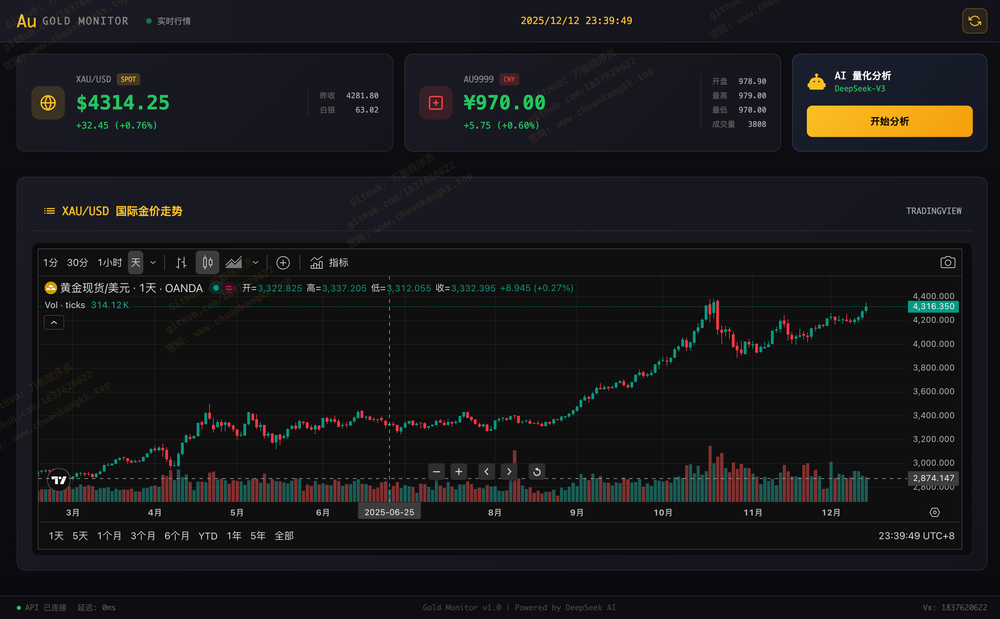
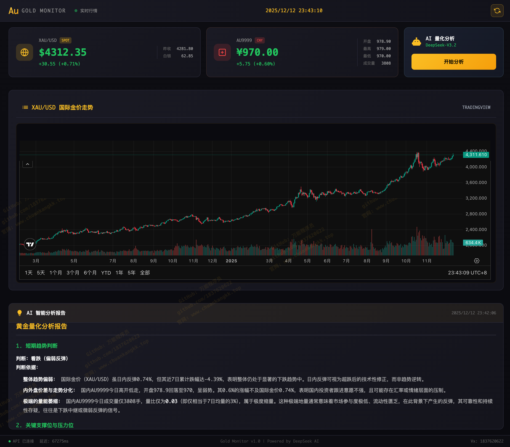

<div align="center">

# 🏆 Gold Monitor - 黄金价格智能监控系统

<p align="center">
  
  
  
  
  
</p>

<p align="center">
  <a href="https://gold.chuankangkk.top"></a>
  
</p>

<p align="center">
  <strong>🚀 实时金价监控 | 📊 专业K线图表 | 🤖 AI量化分析 | 📲 微信推送</strong>
</p>

<p align="center">
  基于 Vue3 + Hono + DeepSeek AI 构建的专业级黄金价格实时监控与智能量化分析平台
</p>

<p align="center">
  <a href="https://gold.chuankangkk.top">🌐 在线演示</a> |
  <a href="https://github.com/1837620622/Gold-Price-Quantitative-Monitoring-System">📦 GitHub</a> |
  <a href="#-订阅金价推送">📲 订阅推送</a> |
  <a href="#-联系作者">💬 联系作者</a>
</p>

</div>

---

## 📲 订阅金价推送

<div align="center">

<table>
<tr>
<td align="center" width="300">


**扫码订阅金价推送**

</td>
<td>

### 🔔 推送功能

- ⏰ **每30分钟** 自动推送最新金价行情
- 📈 **涨跌预警** 涨跌幅超1%自动推送
- 🤖 **AI分析** 包含DeepSeek智能分析摘要
- 📱 **微信接收** 通过微信公众号接收消息

### 📋 推送内容

- 国内AU9999实时价格
- 国际XAU/USD现货价格
- 涨跌幅与趋势分析
- AI量化投资建议

</td>
</tr>
</table>

</div>

---

## 📸 系统预览

<div align="center">
  
  <p><em>▲ 系统主界面 - 实时价格监控与K线走势</em></p>
</div>

<div align="center">
  
  <p><em>▲ AI智能分析报告 - DeepSeek V3.2 量化分析</em></p>
</div>

---

## ✨ 核心功能

<table>
<tr>
<td width="50%">

### 📈 实时价格与跨源容灾
- 国内 AU9999 / AUTD：东方财富 ➔ 新浪 SGE ➔ 理论汇率估算降级
- 国际 XAU/USD 现货：gold-api ➔ 瑞士银行 Swissquote ➔ Yahoo ➔ 新浪外盘
- 国际白银 XAG/USD 与金银比率 (Gold/Silver Ratio) 实时测算
- 美元离岸/在岸汇率多源容灾（open.er-api / 新浪外汇 / Frankfurter / Stooq）

</td>
<td width="50%">

### 📊 专业图表与金银比
- 国际与国内真实日K线，双源容灾清洗无未来数据
- 技术指标自由开关：MA、布林带、成交量、量化评分、MACD、RSI、KDJ(9,3,3)
- 独家「金银比率 (Gold/Silver Ratio)」均值回归分析与配对交易参考
- 国内溢价历史分布与 Z-Score 偏离度监控

</td>
</tr>
<tr>
<td width="50%">

### 🤖 多模型 AI 矩阵与专业研报
- 支持 Cloudflare Workers AI（DeepSeek R1 Distill / Qwen 2.5 72B）免 Key 零成本推演
- 兼容魔搭 ModelScope（DeepSeek-V3.2 / Qwen2.5-72B）、DeepSeek 官方 API、硅基流动 (SiliconFlow)、OpenRouter（免费模型群），按此顺序容灾
- 宏观对冲基金级量化 Prompt：融合通胀、地缘溢价、多因子、枢轴阶梯与情景推演
- AI 故障时无缝降级为自研专家规则引擎，100% 保证高可用响应
- 研报随界面语言生成中文或英文版本

</td>
<td width="50%">

### 🎯 机构级量化与回测矩阵
- 6 个策略并列回测：EMA 趋势、趋势过滤（+MA60）、综合评分、布林反转、溢价回归（需溢价数据）、买入持有
- 机构级绩效评估：夏普 (Sharpe)、索提诺 (Sortino)、卡玛 (Calmar)、盈亏比、胜率、最大回撤
- 每日日内枢轴点梯队 (Pivot Points)：经典 Classic 与斐波那契 Fibonacci 7档阶梯
- 一键复制格式化行情快报，随时分享社群与交易团队

</td>
</tr>
<tr>
<td width="50%">

### 📲 微信推送通知
- PushPlus 频道与群组推送
- 每 30 分钟定时自动广播
- 涨跌幅 1-2% 自动告警
- 优雅 HTML 格式化与移动端排版

</td>
<td width="50%">

### 🎨 金融量化黄金风格与交互
- Vault Noir 视觉：Three.js 3D 金库开场（随滚动推进的镜头与物理金币）；减少动态效果或无 WebGL 时自动降级为静态展示
- 昼夜自动主题与中英文界面（见下文「昼夜主题与中英文」）
- 中国市场红涨绿跌经典视觉标准
- 极致响应式适配手机、平板与桌面宽屏
- 一键复制行情与一键订阅

</td>
</tr>
</table>

---

### 🌓 昼夜主题与中英文

- **昼夜自动切换**：自动模式下，页面按访客位置计算当地日出日落决定日间或夜间主题。位置来自 Cloudflare 边缘提供的国家、城市、时区与经纬度，服务端不记录也不返回 IP；位置不可用时按访客时区的当地时间切换（06:00–18:00 为日间）。页头的「偏好」面板可手动固定日间或夜间，手动选择会被记住。
- **中英文界面**：默认语言按访客所在国家判断（中国大陆、港澳台与新加坡为中文，其余为英文），「偏好」面板可随时切换并记住选择；无法判断国家时按浏览器语言。AI 研报按当前语言生成。
- 位置信息只用于上述两项默认值，不参与行情计算。

---

## 🛠️ 技术架构

```
┌───────────────────────────────────────────────────────────────┐
│                       Gold Monitor 2.0                        │
├───────────────────────────────────────────────────────────────┤
│  Frontend (Vue 3 + Vite 8 + ECharts 6 + Three.js + GSAP)      │
│  ├── 金库开场：Three.js 3D 金库 · GSAP 滚动驱动               │
│  ├── 行情概览 · 枢轴阶梯 · 指标速览 · 一键复制快报            │
│  ├── ECharts 工作台：K线+KDJ、国内溢价、金银比、多策略回测    │
│  ├── 中英文界面 · 昼夜自动主题（日出日落 / 时区回退）         │
│  └── DOMPurify + marked（AI 研报安全渲染）                    │
├───────────────────────────────────────────────────────────────┤
│  Backend (Hono + Cloudflare Workers)                          │
│  ├── providers/  东财/新浪/Swissquote/gold-api/Yahoo/Stooq    │
│  ├── quant/      KDJ/MACD/RSI/OBV/枢轴点/多策略回测矩阵       │
│  ├── market.js   双源校验、金银比率、故障级联、缓存合并       │
│  ├── ai.js       多模型容灾链，最后回落规则引擎               │
│  └── ai-en.js    英文研报提示词与规则摘要                     │
├───────────────────────────────────────────────────────────────┤
│  Data Sources（多层冗余容灾，免费无需强制 Key）               │
│  ├── 国内黄金：东方财富 ➔ 新浪 SGE 行情 ➔ 汇率理论估算        │
│  ├── 国际黄金：gold-api ➔ 瑞士银行 Swissquote ➔ Yahoo ➔ 新浪  │
│  ├── 国际白银：gold-api ➔ Swissquote ➔ 新浪国际               │
│  ├── 汇率接口：open.er-api ➔ 新浪外汇 ➔ Frankfurter ➔ Stooq   │
│  └── 历史日K：东方财富 (国内) / Stooq ➔ Yahoo (国际)          │
└───────────────────────────────────────────────────────────────┘
```

---

## 🚀 快速开始

### 环境要求

- Node.js 20.19+ 或 22.12+（前端 Vite 8 的要求）
- npm 或 pnpm
- Cloudflare 账号（部署用）

### 本地开发

```bash
# 克隆项目
git clone https://github.com/1837620622/Gold-Price-Quantitative-Monitoring-System.git
cd Gold-Price-Quantitative-Monitoring-System

# 启动后端
cd backend
npm install
npm run dev

# 启动前端（新终端）
cd frontend
npm install
npm run dev
```

访问 `http://localhost:3000` 即可查看系统

---

## 📦 部署指南

### Mac / Linux

```bash
# ========== 后端部署 ==========
cd backend

# 安装依赖
npm install

# 配置API密钥
echo "MODELSCOPE_API_KEY=你的密钥" > .dev.vars

# 部署到Cloudflare
npx wrangler login
npx wrangler secret put ADMIN_TOKEN            # 管理接口（推送/监控）的 Bearer Token，必须设置
npx wrangler secret put PUSHPLUS_TOKEN         # PushPlus 微信推送
npx wrangler secret put MODELSCOPE_API_KEY     # AI 分析（可选）
npm run deploy

# ========== 前端部署 ==========
cd ../frontend

# 安装依赖
npm install

# 默认请求 https://gold-backend.chuankangkk.top；如需指向自建后端，构建前设置环境变量 VITE_API_BASE

# 构建并部署
npm run build
npx wrangler pages deploy dist --project-name=gold-monitor
```

### Windows

```powershell
# ========== 后端部署 ==========
cd backend

# 安装依赖
npm install

# 配置API密钥（编辑.dev.vars文件）

# 部署到Cloudflare
npx wrangler login
npx wrangler secret put ADMIN_TOKEN            # 管理接口（推送/监控）的 Bearer Token，必须设置
npx wrangler secret put PUSHPLUS_TOKEN         # PushPlus 微信推送
npx wrangler secret put MODELSCOPE_API_KEY     # AI 分析（可选）
npm run deploy

# ========== 前端部署 ==========
cd ..\frontend

# 安装依赖
npm install

# 构建并部署
npm run build
npx wrangler pages deploy dist --project-name=gold-monitor
```

> 前端安全响应头与 CSP 位于 `frontend/public/_headers`，构建后随 `dist/` 发布；Cloudflare Pages 与 Netlify 均支持该文件。若使用 Netlify，仓库内的 `frontend/netlify.toml` 已配置构建命令与发布目录（Base directory 设为 `frontend`）。
> 管理接口未配置 `ADMIN_TOKEN` 时会返回 503（禁用），这是预期行为。

---

## 📡 API 接口

| 接口 | 方法 | 描述 |
|:-----|:----:|:-----|
| `/api/price/all` | GET | 行情快照：国内/国际价、汇率、溢价、交叉校验、数据源状态 |
| `/api/price/international` | GET | 国际金价（gold-api.com，Yahoo 双源校验） |
| `/api/price/domestic` | GET | 国内 AU9999（估算时 `estimated=true`） |
| `/api/sources` | GET | 数据源健康状态：成功/失败次数、耗时、最近错误 |
| `/api/geo` | GET | 访客地理信息（国家、城市、时区、经纬度），用于默认语言与昼夜主题；不返回 IP，边缘信息缺失时各字段为 `null` |
| `/api/kline?days=30` | GET | 国内日K原始数据（1–250 天） |
| `/api/quant/cn?days=250` | GET | 国内量化结果：指标、信号、关键位、风险、回测、溢价 |
| `/api/quant/intl?days=250` | GET | 国际量化结果（同上，不含溢价） |
| `/api/premium?days=250` | GET | 国内溢价序列与统计 |
| `/api/ratio` | GET | 金银比（Gold/Silver Ratio）当前值与历史统计 |
| `/api/signals` | GET | 量化信号摘要：当前价、信号（方向 / 评分 / 置信度）、关键位与风险，`market=cn\|intl` |
| `/api/analyze` | POST | AI 量化分析（基于量化结果，缓存 15 分钟）；请求体 `lang` 取 `zh` 或 `en`，决定研报语言 |
| `/api/push/status` | GET | 推送状态 |
| `/api/push/test` | POST | 测试推送（需 ADMIN_TOKEN） |
| `/api/push/scheduled` | POST | 定时推送（每半小时，需 ADMIN_TOKEN） |
| `/api/push/force` | POST | 强制推送（无视时间限制，需 ADMIN_TOKEN） |
| `/api/monitor` | GET | 价格监控（自动触发推送，需 ADMIN_TOKEN） |

> 管理接口需在请求头携带 `Authorization: Bearer <ADMIN_TOKEN>`。未配置 `ADMIN_TOKEN` 时，这些接口全部禁用。

---

## 📐 量化说明

| 模块 | 内容 |
|:-----|:-----|
| 技术指标 | MA(5/10/20/60)、EMA(12/26)、MACD(12,26,9，柱 = 2×(DIF−DEA))、RSI(14，Wilder 平滑)、KDJ(9,3,3)、布林带(20, 2σ)、ATR(14)、OBV、20 日年化已实现波动率、回撤 |
| 量化评分 | 7 个分量：EMA 趋势 25、价格 vs MA20 15、MACD 动能 15、RSI 15、KDJ 10、布林 %B 10、溢价 Z 分数 10；按权重加权平均（缺失分量如无溢价数据时自动归一化），映射到 −100 ~ +100 |
| 信号置信度 | 与主方向一致的分量权重占比；|得分| < 0.05 的分量视为中性 |
| 回测 | 信号基于收盘数据，次日生效（无前视偏差）；单边成本 0.05%。6 个策略：EMA 趋势（EMA12 > EMA26 持仓）、趋势过滤（再要求收盘 ≥ MA60）、综合评分（≥20 开仓、≤0 平仓）、布林反转（RSI < 38 且 %B < 0.2 开仓；RSI > 65 或 %B > 0.9 平仓）、溢价回归（Z ≤ −1.2 开仓、Z ≥ 0.5 平仓，需溢价数据）、买入持有 |
| 绩效指标 | 总收益、CAGR、年化波动、夏普、索提诺、卡玛、盈亏比、胜率、最大回撤、最大连续亏损次数 |
| 溢价 | 国内收盘 ÷（国际收盘 × 汇率 ÷ 31.1035）− 1；日线级近似，国内与国际收盘时点不同 |
| 参考区间 | 最新收盘 ± 1 ATR；止损参考为 ± 2 ATR，仅用于风险讨论 |

> 所有量化结果与 AI 分析均为程序计算或模型生成的参考，不构成投资建议。

## 🧪 测试

```bash
cd backend && npm test        # 指标、信号引擎、数据源解析、接口级测试（node:test，无需网络）
cd frontend && npm run build  # 前端构建检查
```

## 📁 项目结构

```
gold-monitor/
├── 📂 backend/                        # 后端（Cloudflare Workers）
│   ├── 📂 src/
│   │   ├── 📄 index.js                # 路由、鉴权、中间件、Cron 入口
│   │   ├── 📄 config.js               # 数据源地址、缓存时长、校验范围、量化参数
│   │   ├── 📄 market.js               # 多源聚合、双源校验、量化缓存入口
│   │   ├── 📄 ai.js                   # AI 解释（以量化结果为输入）
│   │   ├── 📄 ai-en.js                # 英文研报提示词与规则摘要
│   │   ├── 📄 push.js                 # 推送、预警、定时推送
│   │   ├── 📄 templates.js            # PushPlus HTML 模板
│   │   ├── 📂 providers/              # gold / yahoo / stooq / swissquote / sina / fx / eastmoney
│   │   ├── 📂 quant/                  # indicators.js（纯函数）、engine.js（信号与回测）
│   │   └── 📂 lib/                    # http / cache / sources / util
│   ├── 📂 test/                       # node:test 测试（npm test）
│   ├── 📄 package.json
│   └── 📄 wrangler.toml               # Cloudflare 配置
│
├── 📂 frontend/                       # 前端（Vue 3 + Vite）
│   ├── 📂 public/
│   │   ├── 📄 _headers                # Netlify 安全响应头与 CSP
│   │   ├── 📄 favicon.svg
│   │   └── 📷 qrcode.png              # 订阅二维码
│   ├── 📂 src/
│   │   ├── 📄 App.vue                 # 页面布局与 AI 分析流程
│   │   ├── 📄 main.js                 # 入口：挂载应用、滚动与指针效果
│   │   ├── 📄 api.js · format.js · style.css
│   │   ├── 📂 components/             # 行情卡、信号面板、指标速览、图表工作台、数据源抽屉等
│   │   │   └── 📂 vault/              # 金库开场（Three.js 3D 场景与金币）
│   │   ├── 📂 composables/            # useMarket / useQuant / useTheme / useAlerts
│   │   ├── 📂 i18n/                   # 中英文词典（namespaces/ 按组件拆分）
│   │   └── 📂 lib/                    # ECharts 按需引入、图表配色、Markdown 消毒、日出日落（solar.js）、地理信息（geo.js）、GSAP 动效（motion.js）、金库场景（vault/）
│   ├── 📄 index.html
│   ├── 📄 package.json
│   └── 📄 vite.config.js
│
├── 📂 docs/                           # 文档资源
│   ├── 📷 preview-1.png               # 预览图1
│   └── 📷 preview-2.png               # 预览图2
│
└── 📄 README.md
```

---

## ⚙️ 配置说明

### AI 模型配置（多模型容灾）

研报按下表顺序尝试，前一个不可用或失败时自动切换到下一个，全部失败时回落为规则摘要。只需配置其中一个即可：

| 顺序 | 配置项 | 模型 | 说明 |
|:---:|:-----|:-----|:-----|
| 1 | `AI`（Workers AI 绑定） | DeepSeek-R1 Distill / Qwen2.5 等 | 无需 Key，`wrangler.toml` 已绑定 |
| 2 | `MODELSCOPE_API_KEY` | DeepSeek-V3.2 / Qwen2.5-72B | 魔搭 ModelScope |
| 3 | `DEEPSEEK_API_KEY` | deepseek-chat | DeepSeek 官方 API |
| 4 | `SILICONFLOW_API_KEY` | DeepSeek-V3 / Qwen2.5-72B | 硅基流动 |
| 5 | `OPENROUTER_API_KEY` | 免费 / 聚合模型 | OpenRouter |

密钥通过 `npx wrangler secret put <变量名>` 设置；本地开发写入 `backend/.dev.vars`。访客界面为英文时（`lang=en`），研报与提示词均使用英文。

### 数据源配置

| 数据类型 | 来源 | 更新频率 |
|:--------|:-----|:--------|
| 国际金价 | gold-api.com（免费，无需Key） | 实时 |
| 最新汇率 USD/CNY | open.er-api.com（免费，无需Key） | 每日 |
| 历史日K（XAU/USD、USD/CNY） | Stooq（主）；Yahoo Finance（国际日K备用） | 每日 |
| 国际报价校验与昨收 | Yahoo Finance（与 gold-api.com 双源比对，偏差阈值 0.5%） | 实时 |
| 历史汇率（备用） | Frankfurter / ECB | 每日 |
| 国内AU9999 | 东方财富（免费，无需Key） | 实时 |

> 任何数据源失败都会降级或显示错误，不会用随机数据冒充行情。国内价若由汇率估算，会标注“估算”，且不触发涨跌预警。各数据源的成功率、耗时与最近错误可在页头「数据源」中查看。

### 📲 PushPlus 微信推送配置

本项目使用 [PushPlus](https://www.pushplus.plus/) 实现微信群组推送，让你随时随地掌握金价动态。

#### 配置步骤

1. **注册账号**：访问 [PushPlus官网](https://www.pushplus.plus/) 注册并完成实名认证
2. **获取Token**：在个人中心复制你的用户Token
3. **创建群组**（可选）：在"我创建的群组"中新建群组，获取群组编码（Topic）
4. **配置环境变量**：

```bash
# 进入后端目录
cd backend

# 配置 PushPlus Token（必填）
npx wrangler secret put PUSHPLUS_TOKEN
# 输入你的 Token，例如：7dba765a07dc482487fefdc88cdd7e11

# 配置群组编码（可选，不填则只推送给自己）
npx wrangler secret put PUSHPLUS_TOPIC
# 输入群组编码，例如：CK-GOLD

# 重新部署使配置生效
npx wrangler deploy
```

#### 推送规则详解

| 类型 | 触发条件 | 推送内容 | 防重复机制 |
|:-----|:---------|:---------|:-----------|
| **定时推送** | 每 30 分钟 | 国内外金价 + AI分析 | 距上次推送≥30分钟 |
| **预警推送** | 涨跌幅 1%-2% | 异动提醒 + AI分析 | 价格变化≥0.5% |

#### 推送内容说明

每次推送包含 **两条消息**：

1. **金价快报**（即时推送）
   - 国内 AU9999 实时价格
   - 国际 XAU/USD 现货价格
   - 涨跌幅和趋势指示

2. **AI智能分析**（约1分钟后推送）
   - 短期趋势判断
   - 支撑位/压力位分析
   - 操作建议摘要

#### 配额说明

- **定时推送**：48次/天 × 2条 = 96条
- **预警推送**：约5-10次/天 × 2条 = 10-20条
- **每日总计**：约 106-116 条
- **PushPlus免费额度**：200条/天 ✅ 完全够用

---

## 🤝 联系作者

<div align="center">

| 平台 | 联系方式 |
|:----:|:--------|
| 💬 微信 | `1837620622`（传康kk） |
| 📧 邮箱 | `2040168455@qq.com` |
| 🐟 咸鱼 | 万能程序员 |
| 📺 B站 | 万能程序员 |
| 🌐 官网 | [www.chuankangkk.top](https://www.chuankangkk.top) |
| 💻 GitHub | [github.com/1837620622](https://github.com/1837620622) |

</div>

---

<div align="center">

**⭐ 如果这个项目对你有帮助，请给个 Star 支持一下！**

<p>
  
  
</p>

Made with ❤️ by 万能程序员

</div>
